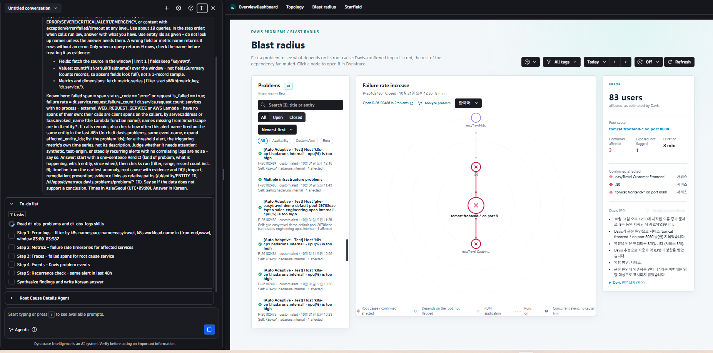
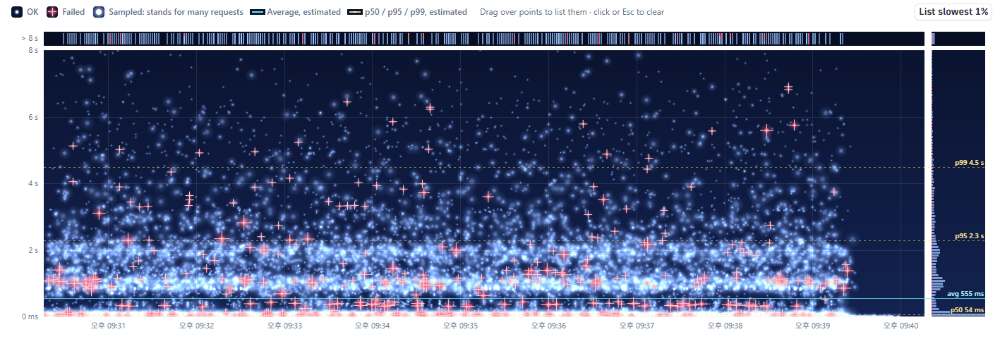

# Overview Dashboard

Dynatrace AppEngine 앱입니다. 세 페이지로 구성됩니다.

| 페이지 | 경로 | 하는 일 |
| --- | --- | --- |
| **Topology** | `/` | RUM 애플리케이션 → 서비스 → Kubernetes 워크로드 / 프로세스 그룹 → 인프라의 트래픽 맵 |
| **Blast radius** | `/blast-radius` | Davis 문제 하나를 근본 원인 중심의 고리로 그려 영향 범위를 보여 줌 |
| **Starfield** | `/starfield` | 요청 하나하나를 별로 찍은 응답시간 산점도. 영역을 드래그해 트레이스를 엶 |

쿼리를 고치기 전에 [docs/dynatrace-query-notes.md](docs/dynatrace-query-notes.md)를 먼저 읽어 주세요.
에러 없이 틀린 숫자를 내는 플랫폼 동작과, 각 설계 결정의 근거(실측 수치 포함)가 정리되어 있습니다.
코딩 에이전트용 작업 규칙은 [AGENTS.md](AGENTS.md)에 있습니다.

## 공통: 세그먼트와 태그 필터

세 페이지 모두 상단에 세그먼트 선택과 서비스 태그 필터가 있습니다. 한 페이지에서 고른 값은 다른 페이지로
옮겨 가도 유지됩니다. 새로 고침하면 초기화됩니다.

- 태그는 여러 개를 고르면 **OR**로 묶입니다. 하나라도 가진 서비스가 대상입니다.
- 엔티티 목록이나 Blast radius의 의존 관계 그래프처럼 좁히면 안 되는 쿼리는 세그먼트를 적용하지 않습니다.

## Topology


네 열로 토폴로지 맵을 그리고, 요약 타일, 노드별 상세 정보, Davis 예측을 함께 보여 줍니다.

- 노드와 요청량은 메트릭에서, 관계는 Smartscape에서, 문제는 `dt.davis.problems`에서 가져옵니다.
- 맵에서는 Pod를 소속 Kubernetes 워크로드 단위로 묶어서 보여 줍니다. 상단 타일은 계속 Pod 단위로 셉니다.
- Kubernetes 밖에서 도는 서비스는 워크로드 대신 실행 중인 프로세스 그룹과 그 호스트를 보여 줍니다.
- 서비스 → 워크로드 트래픽은 입자가 흐르는 Sankey 띠로 그립니다. 값은 `dt.service.request.count`를
  `k8s.workload.name`으로 나눈 것입니다.
- RUM 애플리케이션과 연결되지 않은 진입 서비스는 점선으로 그린 **External callers** 노드에서 트래픽을
  받는 것으로 표시합니다. 이 노드는 모니터링 대상 엔티티가 아니라 화면 표시용 가상 노드입니다.
- 맵 검색, 열마다 그릴 노드 수(브라우저에 기억), 정렬 기준을 고를 수 있습니다. 화면에서 빠진 서비스 수도
  함께 표시합니다.
- 타일은 tenant의 **전체 인벤토리**를, 맵은 트레이스가 닿은 **관계**만 그립니다. 두 숫자가 다른 것은
  정상입니다.

## Blast radius



Davis 문제를 하나 고르면 근본 원인을 가운데 두고, 그것에 의존하는 서비스·프론트엔드·워크로드를 고리로
그립니다. 화면은 세 영역으로 나뉩니다. 위 스크린샷은 데모 환경(easyTravel)에서 찍은 것입니다.

**문제 목록 (왼쪽)**

- 선택한 시간 범위의 Davis 문제를 최신순으로 보여 줍니다. 문제 ID, 제목, 엔티티 이름으로 검색할 수 있습니다.
- 진행 중(Open)과 종료(Closed), 범주(Availability, Error, Custom Alert 등)로 좁힐 수 있습니다.
- 태그 필터는 문제에 연결된 엔티티의 태그(`entity_tags`)로 목록을 좁힙니다. 자동 새로 고침 간격도 고를 수 있습니다.

**영향 그래프 (가운데)**

- 가운데가 근본 원인이고, 바깥 고리로 갈수록 그것에 의존하는 엔티티입니다.
- 빨간 노드와 선은 **Davis가 영향을 확인한** 엔티티입니다. 근본 원인에 의존하지만 Davis가 표시하지 않은
  엔티티는 흐리게, RUM 애플리케이션은 보라색, 실행 관계(runs on)는 점선으로 그립니다.
- 근본 원인 없이 함께 일어난 이벤트(concurrent event)는 인과 관계가 없으므로 의존 관계를 펼치지 않습니다.
- 노드를 누르면 Dynatrace의 해당 엔티티 화면이 열립니다.

**문제 요약 (오른쪽)**

- Davis가 추정한 영향 사용자 수, 근본 원인, 지속 시간을 보여 줍니다.
- "Confirmed affected"는 Davis가 영향을 확인한 엔티티 수, "Exposed, not flagged"는 근본 원인에 의존하지만
  Davis가 표시하지 않은 엔티티 수입니다.
- **Davis 분석**은 문제의 구조화된 필드(근본 원인, 유형별 영향 엔티티, 사용자 수, 범위)로 만든 한글
  요약입니다. Davis 원문은 영어이고 tenant 안에는 번역 기능이 없습니다. 고객 문제 내용을 외부 번역기로
  보내지 않기 위해 이렇게 만들었고, 영어 원문은 "Davis 원문 보기"로 펼쳐 볼 수 있습니다.

**Analyze problem → Assist**

- **Analyze problem**을 누르면 이 문제의 정보로 만든 질문을 Dynatrace Assist에 보내 바로 실행합니다.
  스크린샷 왼쪽처럼 Assist가 에러 로그, 메트릭, 트레이스, 이벤트, 재발 여부 순으로 분석 계획을 세우고
  결론을 고른 언어로 답합니다. 답변 언어는 버튼 옆에서 고르며, 브라우저에 기억됩니다.
- 질문에는 엔티티 ID만 넣고 이름은 넣지 않습니다. 로그 범위를 좁히는 데 필요한 Kubernetes 네임스페이스와
  워크로드 이름만 포함합니다. 질문을 만드는 규칙은 [ui/app/assistPrompt.ts](ui/app/assistPrompt.ts)에
  있습니다.

## Starfield



선택한 시간 창의 요청을 별 하나씩으로 찍습니다. 가로축은 요청이 끝난 시각, 세로축은 걸린 시간입니다.
영역을 드래그하면 그 안의 요청 목록이 나오고, 각 트레이스를 Distributed Tracing 앱의 새 탭으로 엽니다.

- **별:** 크고 밝을수록 더 많은 요청을 대표합니다(샘플링 가중치). 실패는 붉은 십자로 그립니다. 별이 몰린
  구간은 하얗게 번지지 않도록 밝기를 줄입니다.
- **Y 최대와 초과 띠:** Y 최대보다 느린 요청은 차트 위의 얇은 띠에 분 단위 건수로 모입니다. 띠를 드래그하면
  그 요청들이 목록에 나옵니다. 세로축은 선형(기본)과 로그 중에서 고릅니다.
- **분포 막대:** 오른쪽 막대는 높이별 요청 분포입니다. p50·p95·p99(금색 점선)와 평균(하늘색 실선)을 함께
  그립니다. 모두 트레이스 기반 **추정치**입니다. 정확한 값은 서비스 메트릭이 기준입니다.
- **가장 느린 1% 보기:** 드래그하지 않고도 가장 느린 1%의 요청을 목록에 올립니다.
- **선택한 요청 표:** 열 너비를 조정할 수 있습니다. 샘플링 열은 기본으로 숨겨져 있고, 열 설정에서 켜면
  "저장 1/n"(에이전트가 저장하지 않음)과 "읽기 1/n"(저장되어 있지만 이 화면이 읽지 않음)을 구분해 보여 줍니다.
- **시간 범위:** 최근 5/10/15분 프리셋이나 임의의 범위를 고릅니다. 트레이스 보존 기간보다 오래된 날짜는
  고를 수 없습니다. 15분이 넘는 범위를 고르면 그 기간 전체의 **개요 띠**(서비스 메트릭의 요청 수, p95,
  평균)가 나오고, 클릭·드래그·← → 키로 그릴 15분 구간을 고릅니다.
- **요청이 많은 창:** 조회 상한(25,000건)을 넘는 창은 트레이스를 1/10, 1/100처럼 **창 전체에서 고르게**
  읽습니다. 이때 가장 느린 1%와 **실패한 요청은 모두** 읽습니다. 차트 위 파란 안내에 비율이 표시됩니다.
- **Live:** 30초 / 1분 / 5분 간격으로 최근 2분을 다시 읽어 이어 붙입니다. 영역을 선택하거나 브라우저 탭이
  숨겨지면 멈추고, 돌아오면 빈 구간 없이 따라잡습니다. 끝 시각이 "지금"인 범위에서만 켤 수 있습니다.
- **언어:** 화면 문구는 Dynatrace 사용자 언어 설정을 따릅니다. 한국어면 한글, 그 밖에는 영어입니다.
  문구는 [ui/app/starfieldText.ts](ui/app/starfieldText.ts)에 모여 있습니다.

### Starfield 조회 비용

이 앱에서 raw span을 읽는 곳은 Starfield 한 곳뿐입니다. 트레이스 조회는 스캔한 양만큼 "Traces - Query"로
과금되므로 다음을 알아 두세요. 수치는 한 tenant에서 실측한 값입니다.

- 10분 창을 한 번 읽으면 약 0.5 GiB를 스캔합니다.
- Live는 갱신마다 약 0.1 GiB를 스캔합니다. 10초 간격이면 화면 하나가 시간당 약 38 GiB였습니다. 그래서
  간격은 30초부터 고를 수 있고, 탭이 숨겨지면 갱신을 멈춥니다. Live를 끄는 것은 사용자 몫입니다.
- 개요 띠, 보존 기간, 사전 측정 조회는 메트릭이나 시스템 테이블을 읽거나 1/100만 읽어서 거의 비용이 없습니다.

## 시작하기

Node.js 20.19 이상이 필요합니다.

```bash
npm install
npm run start     # 개발 서버 실행. app.config.json에 지정된 tenant로 앱이 열립니다
```

## 대상 tenant 지정

`start`와 `deploy`가 어느 tenant로 연결될지는 [app.config.json](app.config.json)의
`environmentUrl`이 정합니다. 다른 tenant에 배포하려면 이 값을 바꿔 주세요.

## 배포

```bash
npm run lint
npm run build
npm run deploy
```

**배포할 때마다 먼저 `app.config.json`의 `app.version`을 올려 주세요.** 한 tenant에 설치된 버전은
다시 쓸 수 없어서, 이미 설치된 버전에 내용만 바꿔 배포하면 다음 에러가 납니다.
`Cannot install app with version X because the same version is already installed with a different checksum.`
이 검사는 tenant마다 따로 합니다. 한 tenant에서 비어 있는 버전이 다른 tenant에서는 이미 쓰였을 수 있습니다.

## 필요한 scope

`app.config.json`에 선언되어 있습니다. scope가 바뀌면 앱을 처음 열 때 사용자 동의를 받습니다.

| Scope | 용도 |
| --- | --- |
| `storage:buckets:read` | 모든 Grail 쿼리. 없으면 쿼리는 성공하지만 결과가 0건으로 나옴. Starfield의 트레이스 보존 기간 조회에도 사용 |
| `storage:metrics:read` | RUM, 서비스, 호스트, Kubernetes 메트릭. Starfield 개요 띠 |
| `storage:smartscape:read` | Smartscape 노드와 엣지 |
| `storage:entities:read` | 기존 엔티티 모델(`dt.entity.service`의 호출자, 이름, 태그) |
| `storage:events:read` | `dt.davis.problems` |
| `storage:spans:read` | Starfield의 root span 조회 |
| `storage:filter-segments:read` | 세그먼트 목록과 적용 |
| `davis:analyzers:execute` | 상세 패널의 Davis 예측 |
| `storage:user.events:read` | 선언만 되어 있음. 현재 user event를 읽는 쿼리는 없음 |

## 커밋하면 안 되는 것

`.dt-app/` 폴더에는 마지막 `dt-app` 명령이 받은 OAuth 토큰이 들어 있습니다. `.gitignore`로
제외되어 있으니 이 설정을 유지해 주세요.

README나 문서에 넣는 스크린샷에는 고객 tenant의 서비스 이름, 계정 ID, 태그, 문제 제목이 보이지 않게 해
주세요. `docs/images/starfield.png`는 이름이 없는 차트 부분만 잘라 넣은 것입니다.
