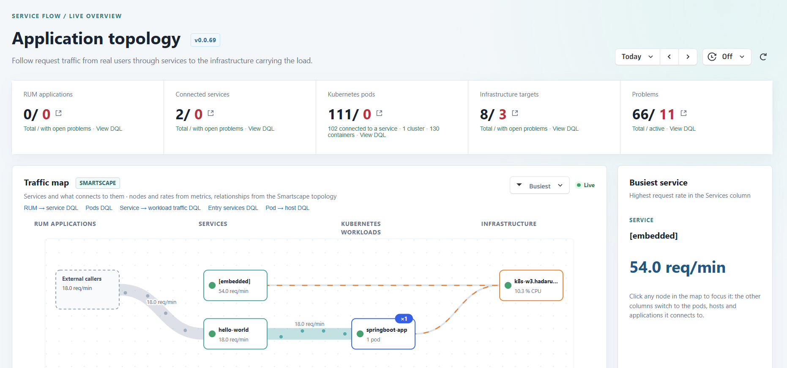

# Overview Dashboard

Dynatrace AppEngine 앱입니다. **RUM 애플리케이션 → 서비스 → Kubernetes 워크로드 → 인프라** 네 열로
토폴로지 맵을 그리고, 요약 타일, 노드별 상세 정보, Davis 예측을 함께 보여 줍니다.



- 노드와 요청량은 메트릭에서, 관계는 Smartscape에서, 문제는 `dt.davis.problems`에서 가져옵니다.
- 맵에서는 Pod를 소속 Kubernetes 워크로드 단위로 묶어서 보여 줍니다. 상단 타일은 계속 Pod 단위로 셉니다.
- 서비스 → 워크로드 트래픽은 입자가 흐르는 Sankey 띠로 그립니다. 값은 `dt.service.request.count`를
  `k8s.workload.name`으로 나눈 것입니다.
- RUM 애플리케이션과 연결되지 않은 진입 서비스는 점선으로 그린 **External callers** 노드에서 트래픽을
  받는 것으로 표시합니다. 이 노드는 모니터링 대상 엔티티가 아니라 화면 표시용 가상 노드입니다.

쿼리를 고치기 전에 [docs/dynatrace-query-notes.md](docs/dynatrace-query-notes.md)를 먼저 읽어 주세요.
에러 없이 틀린 숫자를 내는 플랫폼 동작이 정리되어 있습니다. 코딩 에이전트용 작업 규칙은
[AGENTS.md](AGENTS.md)에 있습니다.

## 시작하기

Node.js 20.19 이상이 필요합니다.

```bash
npm install
npm run start     # 개발 서버 실행. app.config.json에 지정된 tenant로 앱이 열립니다
```

## 대상 tenant 지정

`start`와 `deploy`가 어느 tenant로 연결될지는 [app.config.json](app.config.json)의
`environmentUrl`이 정합니다. 다른 tenant에 배포하려면 이 값을 바꿔 주세요.

## 배포

```bash
npm run lint
npm run build
npm run deploy
```

**배포할 때마다 먼저 `app.config.json`의 `app.version`을 올려 주세요.** 한 tenant에 설치된 버전은
다시 쓸 수 없어서, 이미 설치된 버전에 내용만 바꿔 배포하면 다음 에러가 납니다.
`Cannot install app with version X because the same version is already installed with a different checksum.`
이 검사는 tenant마다 따로 합니다. 한 tenant에서 비어 있는 버전이 다른 tenant에서는 이미 쓰였을 수 있습니다.

## 필요한 scope

`app.config.json`에 선언되어 있습니다. scope가 바뀌면 앱을 처음 열 때 사용자 동의를 받습니다.

| Scope | 용도 |
| --- | --- |
| `storage:buckets:read` | 모든 Grail 쿼리. 없으면 쿼리는 성공하지만 결과가 0건으로 나옴 |
| `storage:metrics:read` | RUM, 서비스, 호스트, Kubernetes 메트릭 |
| `storage:smartscape:read` | Smartscape 노드와 엣지 |
| `storage:entities:read` | 기존 엔티티 모델(`dt.entity.service`의 호출자, 이름) |
| `storage:events:read` | `dt.davis.problems` |
| `storage:spans:read`, `storage:user.events:read` | 선언만 되어 있음. 현재 raw span이나 user event를 읽는 쿼리는 없음 |
| `davis:analyzers:execute` | 상세 패널의 Davis 예측 |

## 커밋하면 안 되는 것

`.dt-app/` 폴더에는 마지막 `dt-app` 명령이 받은 OAuth 토큰이 들어 있습니다. `.gitignore`로
제외되어 있으니 이 설정을 유지해 주세요.
